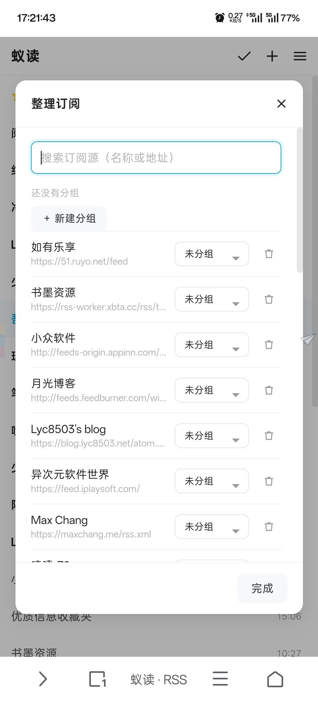
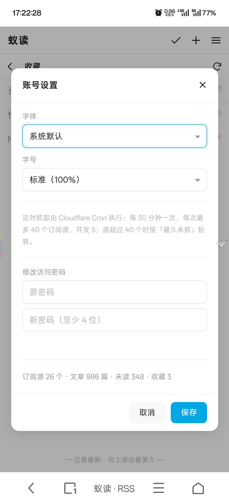
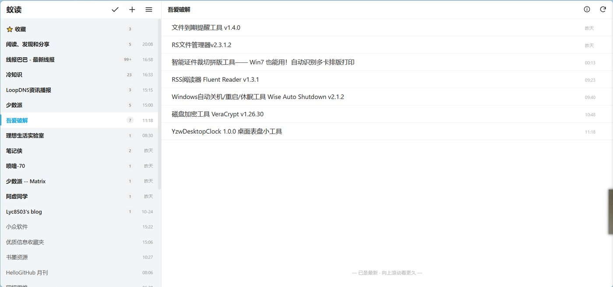

# 蚁读 · Ant Reader

自托管的 RSS 阅读器，界面照**蚁阅**的极简风格重写：白底、极细分割线、纯文字列表（标题 + 右侧日期）、亮蓝作为唯一强调色、未读深黑 / 已读浅灰。

后端跑在 **Cloudflare Workers + D1**，前端是零构建的原生 HTML/CSS/JS，**运行时依赖 0**——克隆下来一条 `wrangler deploy` 就上线，不用打包、不用买服务器。

手机是三级页面（订阅源 → 文章列表 → 展开正文），桌面是两栏（左侧订阅源 + 右侧文章列表），两者共用同一套极简列表。

---

## 界面预览

**手机端：订阅源 → 文章列表（只显示未读）→ 点一次原地展开正文**

| 订阅源（⭐️收藏 + 未读徽章） | 文章列表 | 展开正文 |
|:---:|:---:|:---:|
|  |  |  |

**收藏 / 侧边菜单 / 整理订阅 / 账号设置**

| ⭐️ 收藏 | 侧边菜单 | 整理订阅 | 账号设置（字体字号） |
|:---:|:---:|:---:|:---:|
|  |  |  |  |

**桌面端**



---

## 功能

### 订阅管理
- 添加时自动发现 Feed——填站点首页即可，自动找到 RSS/Atom 地址
- 分组、改名、换组、删除；「订阅源信息」面板能看到文章数、最新一篇、最后抓取、抓取状态（失败显示具体原因）、站点、添加时间，也能直接删源
- 「整理订阅」面板：顶部按名称/地址即时搜索，改动分组用下拉，新建分组走弹窗
- OPML 一键导出／导入（导入自动建分组，重复源自动跳过）
- 单源手动刷新 + 全局刷新 + 下拉刷新 + Cron 每 30 分钟自动抓取

### 阅读
- **默认只看未读**：点开订阅源只列出未读文章，界面只剩标题 + 右侧日期；已读不占地方
- **要看历史就下拉**：列表顶部下拉（「↑ 下拉加载更久」）或继续向上滚动，更早的文章（多半已读）逐段带出来，插入位置做滚动补偿，当前阅读不跳
- **纯时间序**：旧的在上面、新的在下面；打开时把最旧的一条未读顶到屏幕上方，从断点续读
- **读到这里**：点开一篇时，它和列表里比它更旧的未读一起标已读（下界为当前已加载的最旧一条，不会误清历史；一次超过 30 篇会先确认）
- **点一次原地展开正文**（HTML 渲染、保留图片），再点一次跳原文；桌面同样原地展开
- 顶部 ✓ 一键把当前订阅源／分组全部标已读；单篇可标已读/未读、收藏
- ⭐️ 收藏列表独立入口，按时间序展示
- 正文服务端净化后渲染（白名单标签、去脚本、去事件属性、相对链接转绝对）

### 界面
- 可自定义**字体**（系统默认 / 无衬线 / 衬线 / 楷体 / 等宽）与**字号**（90% / 100% / 110% / 125%），选完即时生效，记在本机
- 白天／夜间主题，跟随本地记忆
- 桌面顶栏只占左栏宽度，与右栏标题行同高，一眼干净
- 桌面快捷键：`j`/`k` 上下篇、`o` 开原文、`m` 已读、`s` 收藏、`r` 刷新

### 数据
- 每个源最多保留 300 条，抓取时自动裁掉最旧的
- 可选按天数清理已读、未收藏的旧文章（`retention_days` 默认 0，即不清理）

### 安全
- 单用户口令登录，PBKDF2-SHA256 10 万轮
- HMAC-SHA256 签名 HttpOnly Cookie 会话
- 首次访问引导设置密码，无默认口令

### 兼容
- RSS 2.0、Atom 1.0、RSS 1.0 (RDF)、JSON Feed

---

## 技术栈

| 层 | 选型 | 说明 |
|---|---|---|
| 运行时 | Cloudflare Workers | 单入口 `src/index.js`，ESM 模块 |
| 数据库 | Cloudflare D1 (SQLite) | 订阅源、文章、分组、设置四张表 |
| 静态资源 | Workers Static Assets | `public/` 直接托管，零构建 |
| 定时任务 | Workers Cron Triggers | `*/30 * * * *`，每轮最多 40 源、并发 5 |
| 前端 | 原生 HTML/CSS/JS | 无框架、无构建，约 40 KB |

`package.json` 里只有 `wrangler` 一个 devDependency，运行时依赖为 0。

---

## 部署到 Cloudflare

### 0. 前置条件

- Cloudflare 账号（免费版够：Workers 每日 10 万次请求，D1 免费 5 GB 存储 / 500 万行读）
- 本地 Node.js 18+（只在部署时用）
- **可选**：一个已托管在 Cloudflare 的域名（想绑自定义域名时需要）

### 1. 克隆并登录

```bash
git clone https://github.com/rentianyu/ant-reader.git
cd ant-reader
npm install
npx wrangler login
```

无桌面环境时改用 API Token：

```bash
export CLOUDFLARE_API_TOKEN="你的 token"
export CLOUDFLARE_ACCOUNT_ID="你的 account id"
```

### 2. 创建 D1 数据库

```bash
npx wrangler d1 create ant-reader-db
```

把输出里的 `database_id` 填进 `wrangler.jsonc`：

```jsonc
"d1_databases": [
  { "binding": "DB", "database_name": "ant-reader-db", "database_id": "xxxxxxxx-xxxx-xxxx-xxxx-xxxxxxxxxxxx" }
]
```

### 3. 建表

```bash
npm run db:init          # 远端库
npm run db:init:local    # 本地开发库（可选）
```

等价于 `npx wrangler d1 execute ant-reader-db --remote --file=./schema.sql`，建 `groups` / `feeds` / `items` / `settings` 四张表与四个索引。

### 4. 部署

```bash
npm run deploy
```

输出会给出 `https://ant-reader.<你的子域>.workers.dev`。首次打开要求设置访问密码（至少 4 位）。

> 刚部署完立刻访问偶尔 522/404，是边缘传播延迟，等 30 秒再刷。

### 5. 绑定自定义域名（可选）

**方式 A（推荐）**：`wrangler.jsonc` 用 `routes`，同时 DNS 加一条 `AAAA rss → 100::`（橙色云／已代理）：

```jsonc
"routes": [{ "pattern": "rss.example.com/*", "zone_name": "example.com" }]
```

**方式 B**：Workers 自定义域：

```jsonc
"routes": [{ "pattern": "rss.example.com", "custom_domain": true }]
```

两种都能用。A 走 zone 的通配符证书，不会为这个子域单独签证书、也就不会写进 CT 日志；B 会多签一张并暴露子域名。

### 6. 会话密钥（可选）

不设置时首次启动会在 D1 `settings` 表生成随机密钥。想显式指定：

```bash
npx wrangler secret put SESSION_SECRET
```

### 7. 验证

```bash
curl https://你的域名/api/health      # 返回 {"ok":true,...} 即正常
```

然后打开站点 → 设密码 → 添加第一个订阅源。

### 部署参数速查

| 参数 | 值 |
|---|---|
| Worker 名 | `ant-reader` |
| D1 绑定名 / 库名 | `DB` / `ant-reader-db` |
| 静态资源目录 / 绑定 | `./public` / `ASSETS` |
| SPA 兜底 | `not_found_handling: single-page-application` |
| Worker 优先接管 | `/api/*` |
| Cron | `*/30 * * * *` |
| 兼容日期 | `2026-05-03` |
| 每源保留条数 | 300（`src/feeds.js` 的 `FEED_KEEP_ITEMS`） |

### 常见问题

**`iteration counts above 100000 are not supported`**
Workers 生产环境 PBKDF2 迭代上限 10 万轮（本地 workerd 不限，所以本地过、线上报错）。代码已固定 100000，别调高。

**本地 `wrangler dev` 报 `SQLITE_IOERR disk I/O error`**
把本地状态目录指到本机磁盘：

```bash
npx wrangler dev --persist-to /tmp/wrstate
```

**抓取一直失败、信息面板显示 HTTP 403**
部分站点（如吾爱破解）有反爬，Workers 出口 IP 会被拦。这是源站策略，不是阅读器故障。

**Cron 没跑**
Cron 只在线上生效，`wrangler dev` 不触发；本地测试用「立即刷新」或下拉刷新。

---

## 本地开发

```bash
npm run db:init:local
npm run dev          # http://127.0.0.1:8787
```

首次访问同样引导设密码。前端改动刷新页面即可，无需构建。

```bash
node tests/run.mjs   # 核心逻辑单测（57 项）
```

---

## 目录结构

```
ant-reader/
├── src/
│   ├── index.js          # Worker 入口：路由分发 + Cron
│   ├── api.js            # HTTP API（认证、订阅、文章、OPML、设置）
│   ├── db.js             # D1 查询封装
│   ├── feeds.js          # 抓取、同步、Feed 发现、OPML 读写
│   ├── feed-parser.js    # 零依赖 XML 解析 + RSS/Atom/RDF/JSON Feed 归一化
│   ├── sanitize.js       # 正文 HTML 白名单净化
│   └── auth.js           # PBKDF2 口令 + HMAC 会话
├── public/
│   ├── index.html        # SPA 骨架
│   ├── app.css           # 全部样式（含响应式、夜间模式、字体变量）
│   ├── app.js            # 前端逻辑
│   └── favicon.svg
├── docs/screenshots/     # README 截图
├── tests/                # 单测 + 无头浏览器验收 + 线上探针
├── schema.sql            # D1 表结构
└── wrangler.jsonc
```

---

## API 一览

所有接口在 `/api` 下，除 `health` / `status` / `setup` / `login` 外都需要会话 Cookie。

| 方法 | 路径 | 说明 |
|---|---|---|
| GET | `/health` | 健康检查 |
| GET | `/status` | 初始化状态、登录状态、计数 |
| POST | `/setup` | 首次设置密码 |
| POST | `/login` / `/logout` | 登录 / 退出 |
| GET | `/bootstrap` | 分组 + 订阅源 + 计数 + 设置 |
| POST | `/feeds` | 添加订阅（`{url,groupId}`） |
| POST | `/feeds/discover` | 只探测，不入库 |
| PATCH/DELETE | `/feeds/:id` | 改名、换组、删除 |
| POST | `/feeds/:id/refresh` | 刷新单个源 |
| POST | `/refresh` | 批量刷新（按最久未抓排序） |
| GET | `/items` | 列表（`feed_id`/`group_id`/`unread`/`read`/`starred`/`q`/`order`/`before`/`limit`/`offset`） |
| GET/PATCH | `/items/:id` | 详情 / 改已读、收藏 |
| POST | `/read-before` | 「读到这里」：把某篇及更早的未读标已读（可带 `minTs` 下界） |
| POST | `/read-all` | 全部已读（可限定 feed / group） |
| GET/POST | `/opml` | 导出 / 导入 |
| POST | `/groups`、PATCH/DELETE `/groups/:id` | 分组 |
| PATCH | `/settings` | 其他设置 |
| POST | `/password` | 改密码 |

`/items` 的两个关键参数：

- `order=asc|desc`：默认时间升序（旧→新）；前端首屏用 `desc` 取最新一页再反转渲染，实现「打开即在最新、向上翻历史」
- `before=<时间戳>`：只要比该时间更早的文章（含已读），这就是「下拉加载更久」用的游标

---

## 设计说明

- **为什么自己写 XML 解析**：Workers 没有 DOM，引入 `fast-xml-parser` 就要打包步骤。自带约 200 行容错解析器，能覆盖常见畸形写法（未转义 HTML、CDATA、命名空间前缀、属性内含 `>`），还能直接在 Node 里跑单测。
- **为什么默认只看未读**：RSS 的痛点是未读堆积。默认把已读挡在外面，列表就只有"待读清单"，需要考古时再下拉带出历史。
- **为什么时间正序（旧上新下）**：配合"最旧未读贴顶 + 读到这里"，形成一条从旧到新的连续阅读流水线；新文章永远在底部。
- **为什么不在服务端抓正文**：标准版只存 Feed 自带内容。遇到只给摘要的源，展开区底部有「原文」入口。
- **Cron 轮转**：每次取 `last_fetch_at` 最早的 40 个源、并发 5，避开 Workers 子请求上限与执行时长；源超过 40 个自动轮转。
- **保留策略**：默认只靠「每源 300 条」硬上限，不按天数删（`retention_days` 默认 0）；设成正数后每次 Cron 结束会删超期、已读、未收藏的文章。

---

## 测试

```bash
node tests/run.mjs     # 核心逻辑单测（57 项）
```

浏览器端另有：

- `tests/ui_e2e.py`：无头 Chromium + CDP，60+ 项 UI 断言（本地库，`--reset-unread` 重置数据）
- `tests/online_probe.py`：线上只读探针（截图 + 时间序/定位校验，不改数据）
- `tests/dev_env.sh`：一键恢复本地开发环境（wrangler + 本地 D1 + 6 个种子源）

---

## 许可

MIT
