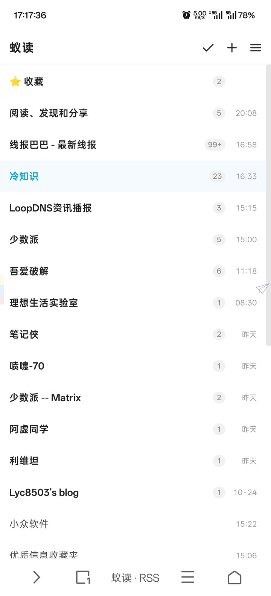
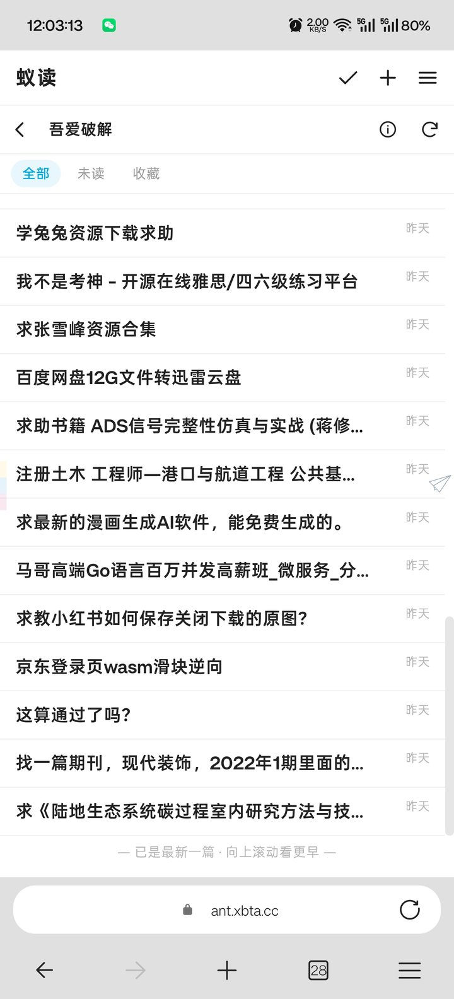
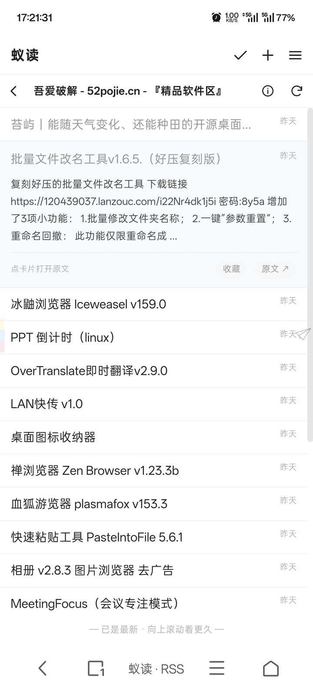
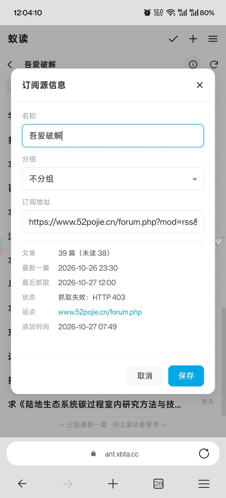
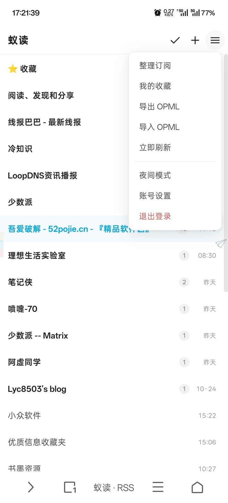
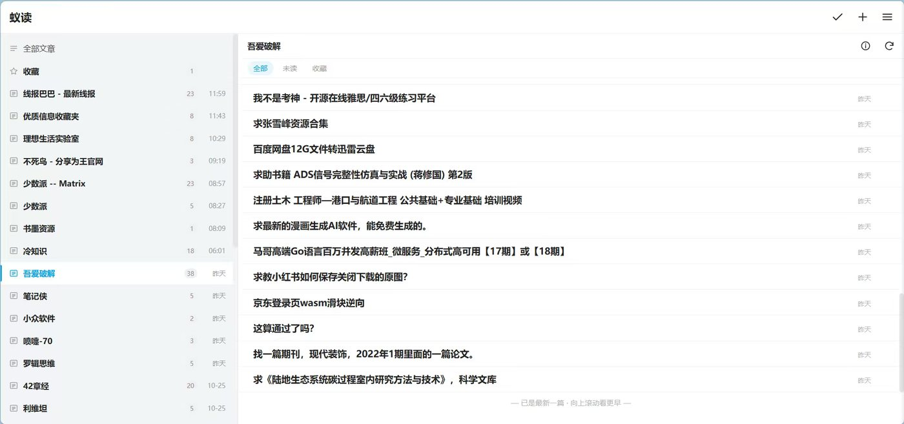
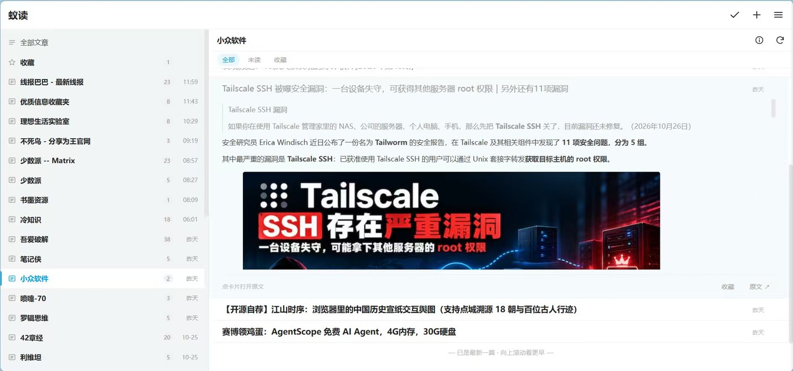

# 蚁读 · Ant Reader

自托管的 RSS 阅读器，界面参照**蚁阅**的视觉语言重写：白底、极浅分割线、单列信息流、线性图标、浅灰胶囊未读徽章、亮蓝作为唯一强调色。

后端跑在 **Cloudflare Workers + D1**，前端是零构建的原生 HTML/CSS/JS，**运行时依赖 0**——克隆下来只要一条 `wrangler deploy` 就能上线，不用打包、不用服务器。

手机端是单列三级页面（订阅源 → 文章 → 阅读），桌面端自动变成两栏（订阅源 + 列表），选中文章后右侧展开正文变成三栏。

---

## 界面预览

**手机端：订阅源 → 文章列表 → 列表内展开**

| 订阅源（未读徽章 + 更新时间） | 文章列表（旧上·新下） | 点一次原地展开 |
|:---:|:---:|:---:|
|  |  |  |

**订阅源信息与侧边菜单**

| 订阅源信息（可改名／换组） | 侧边菜单（OPML／夜间／账号） |
|:---:|:---:|
|  |  |

**桌面端：两栏列表 → 三栏阅读**





---

## 功能

### 订阅管理
- 添加时自动发现 Feed——填站点首页即可，自动找到 RSS/Atom 地址
- 分组、改名、换组、删除；订阅源信息面板里能看到文章数、最新一篇、最后抓取、抓取状态（失败会显示具体原因）、站点、添加时间，也能直接删除该源
- 「整理订阅」面板：默认列出全部源并支持按名称/地址即时搜索，新建分组走弹窗（点「＋ 新建分组」→ 填名字）
- OPML 一键导出／导入（导入自动建分组，重复源自动跳过）
- 单源手动刷新 + 全局刷新 + Cron 每 30 分钟自动抓取（每轮最多 40 个源、并发 5，源多时按「最久未抓」轮转）

### 阅读
- **纯时间序列表**：旧的在上面、新的在下面；打开时自动把**最旧的一条未读**顶到屏幕上方（没有未读则落到底部），从断点续读；向上滚动自动补更早的历史文章，滚动位置不跳
- **未读/已读一眼区分**：未读是深黑加粗，已读转浅灰
- **列表即读**：点一次在卡片内原地展开正文（HTML 渲染，保留图片与排版），再点一次跳原文
- **读到这里**：点开一篇时，它和列表里比它更旧的未读一起标为已读；下界取「当前已加载列表里最旧的一条」，不会误清视野之外的历史；一次超过 30 篇会弹确认
- 全部／未读／收藏三个筛选；标记已读、标记未读、收藏
- 正文服务端净化后渲染（白名单标签、去脚本、去事件属性、相对链接转绝对）
- 每个源最多保留 300 条，抓取时自动裁掉最旧的；另可选按天数清理已读、未收藏的旧文章（默认关闭）

### 界面
- 白天／夜间主题，跟随本地记忆
- 桌面快捷键：`j`/`k` 上下篇、`o` 开原文、`m` 已读、`s` 收藏、`r` 刷新
- 下拉刷新（列表、订阅源列表均可）
- 移动端底部提示「已是最新一篇 · 向上滚动看更早」

### 安全
- 单用户口令登录，PBKDF2-SHA256 10 万轮哈希
- HMAC-SHA256 签名的 HttpOnly Cookie 会话
- 首次访问引导设置密码，无默认口令

### 兼容
- RSS 2.0、Atom 1.0、RSS 1.0 (RDF)、JSON Feed

---

## 技术栈

| 层 | 选型 | 说明 |
|---|---|---|
| 运行时 | Cloudflare Workers | 单入口 `src/index.js`，ESM 模块 |
| 数据库 | Cloudflare D1 (SQLite) | 订阅源、文章、分组、设置四张表 |
| 静态资源 | Workers Static Assets | `public/` 直接托管，零构建 |
| 定时任务 | Workers Cron Triggers | `*/30 * * * *` |
| 前端 | 原生 HTML/CSS/JS | 无框架、无构建，约 30 KB |

`package.json` 里只有 `wrangler` 一个 devDependency，运行时依赖为 0。

---

## 部署到 Cloudflare

### 0. 前置条件

- Cloudflare 账号（免费版足够：Workers 免费额度每日 10 万次请求，D1 免费 5 GB 存储 / 500 万行读）
- 本地 Node.js 18+（只在部署时用）
- **可选**：一个已托管在 Cloudflare 的域名（想用自定义域名时需要）

### 1. 克隆并登录

```bash
git clone https://github.com/rentianyu/ant-reader.git
cd ant-reader
npm install
npx wrangler login
```

`wrangler login` 会拉起浏览器授权；无桌面环境时改用 API Token：

```bash
export CLOUDFLARE_API_TOKEN="你的 token"
export CLOUDFLARE_ACCOUNT_ID="你的 account id"
```

### 2. 创建 D1 数据库

```bash
npx wrangler d1 create ant-reader-db
```

会输出形如下面的结果，把 `database_id` 填进 `wrangler.jsonc`：

```
✅ Successfully created DB 'ant-reader-db'
database_id = "xxxxxxxx-xxxx-xxxx-xxxx-xxxxxxxxxxxx"
```

```jsonc
// wrangler.jsonc
"d1_databases": [
  {
    "binding": "DB",
    "database_name": "ant-reader-db",
    "database_id": "xxxxxxxx-xxxx-xxxx-xxxx-xxxxxxxxxxxx"  // ← 换成你的
  }
]
```

### 3. 建表

```bash
npm run db:init          # 远端库建表
npm run db:init:local    # 本地开发库建表（可选）
```

等价于 `npx wrangler d1 execute ant-reader-db --remote --file=./schema.sql`，会创建 `groups` / `feeds` / `items` / `settings` 四张表与四个索引。

### 4. 部署

```bash
npm run deploy
```

输出里会给出访问地址 `https://ant-reader.<你的子域>.workers.dev`。首次打开会要求设置访问密码（至少 4 位）。

> 刚部署完立刻访问偶尔会 522/404，这是边缘节点传播延迟，等 30 秒再刷新即可。

### 5. 绑定自定义域名（可选）

**方式 A（推荐）**：`wrangler.jsonc` 里用 `routes`，同时在 DNS 加一条 `AAAA rss → 100::`（橙色云 / 已代理）：

```jsonc
"routes": [{ "pattern": "rss.example.com/*", "zone_name": "example.com" }]
```

**方式 B**：用 Workers 自定义域：

```jsonc
"routes": [{ "pattern": "rss.example.com", "custom_domain": true }]
```

两种都能用。A 的好处是走 zone 的通配符证书，不会给这个子域单独签发证书、也就不会写进 CT 日志；B 会多签一张证书并暴露子域名。

### 6. 会话密钥（可选）

不设置时，首次启动会在 D1 的 `settings` 表自动生成一个随机密钥。想显式指定（多环境共用或轮换）：

```bash
npx wrangler secret put SESSION_SECRET
```

### 7. 验证

```bash
curl https://你的域名/api/health
```

返回 `{"ok":true,...}` 即正常。首次访问站点 → 设置密码 → 添加第一个订阅源。

### 部署参数速查

| 参数 | 值 |
|---|---|
| Worker 名 | `ant-reader` |
| D1 绑定名 / 库名 | `DB` / `ant-reader-db` |
| 静态资源目录 / 绑定 | `./public` / `ASSETS` |
| SPA 兜底 | `not_found_handling: single-page-application` |
| Worker 优先接管 | `/api/*` |
| Cron | `*/30 * * * *`（每 30 分钟） |
| 兼容日期 | `2026-05-03` |
| 每源保留条数 | 300（`src/feeds.js` 的 `FEED_KEEP_ITEMS`） |

### 常见问题

**`iteration counts above 100000 are not supported`**
Workers 生产环境 PBKDF2 迭代上限是 10 万轮（本地 workerd 不限制，所以本地通过、线上报错）。代码里已固定 100000，不要为了"更安全"调高。

**本地 `wrangler dev` 报 `SQLITE_IOERR disk I/O error`**
把本地状态目录指到本机磁盘（不要放在网络挂载/虚拟文件系统上）：

```bash
npx wrangler dev --persist-to /tmp/wrstate
```

**抓取一直失败、信息面板显示 HTTP 403/Cloudflare 挑战**
部分站点（如吾爱破解）有反爬，Workers 出口 IP 会被拦。这是源站策略问题，不是阅读器故障。

**Cron 没跑**
Cron 只在线上生效，`wrangler dev` 不会触发；本地测试用「立即刷新」按钮或 `/api/refresh`。

---

## 本地开发

```bash
npm run db:init:local
npm run dev          # http://127.0.0.1:8787
```

首次访问同样引导设置密码。前端改动直接刷新页面即可，无需构建。

```bash
node tests/run.mjs   # 核心逻辑单测（57 项）
```

---

## 目录结构

```
ant-reader/
├── src/
│   ├── index.js          # Worker 入口：路由分发 + Cron
│   ├── api.js            # HTTP API（认证、订阅、文章、OPML、设置）
│   ├── db.js             # D1 查询封装
│   ├── feeds.js          # 抓取、同步、Feed 发现、OPML 读写
│   ├── feed-parser.js    # 零依赖 XML 解析 + RSS/Atom/RDF/JSON Feed 归一化
│   ├── sanitize.js       # 正文 HTML 白名单净化
│   └── auth.js           # PBKDF2 口令 + HMAC 会话
├── public/
│   ├── index.html        # SPA 骨架
│   ├── app.css           # 全部样式（含响应式与夜间模式）
│   ├── app.js            # 前端逻辑
│   └── favicon.svg
├── docs/screenshots/     # README 截图
├── tests/                # 单测 + 无头浏览器验收脚本
├── schema.sql            # D1 表结构
└── wrangler.jsonc
```

---

## API 一览

所有接口在 `/api` 下，除 `health` / `status` / `setup` / `login` 外都需要会话 Cookie。

| 方法 | 路径 | 说明 |
|---|---|---|
| GET | `/health` | 健康检查 |
| GET | `/status` | 初始化状态、登录状态、计数 |
| POST | `/setup` | 首次设置密码 |
| POST | `/login` / `/logout` | 登录 / 退出 |
| GET | `/bootstrap` | 分组 + 订阅源 + 计数 + 设置 |
| POST | `/feeds` | 添加订阅（`{url,groupId}`） |
| POST | `/feeds/discover` | 只探测，不入库 |
| PATCH/DELETE | `/feeds/:id` | 改名、换组、删除 |
| POST | `/feeds/:id/refresh` | 刷新单个源 |
| POST | `/refresh` | 批量刷新（按最久未抓排序） |
| GET | `/items` | 列表（`feed_id`/`group_id`/`unread`/`read`/`starred`/`q`/`order`/`limit`/`offset`） |
| GET/PATCH | `/items/:id` | 详情 / 改已读、收藏 |
| POST | `/read-all` | 全部已读（可限定 feed） |
| GET/POST | `/opml` | 导出 / 导入 |
| POST | `/groups`、PATCH/DELETE `/groups/:id` | 分组 |
| PATCH | `/settings` | 刷新间隔等 |
| POST | `/password` | 改密码 |

`/items` 支持 `order=asc|desc`：默认按发布时间升序（旧→新）；`desc` 用于首屏取「最新一页」，前端取回后反转渲染，从而实现「打开即在最新、向上翻历史」。

---

## 设计说明

- **为什么自己写 XML 解析**：Workers 没有 DOM，引入 `fast-xml-parser` 就要打包步骤。自带一个约 200 行的容错解析器，能覆盖 RSS/Atom/RDF 的常见畸形写法（未转义 HTML、CDATA、命名空间前缀、属性内含 `>`），并且可以直接在 Node 里跑单测。
- **为什么不在服务端做正文抓取**：标准版只存 Feed 自带内容。遇到只给摘要的源，阅读页底部会出现「去原文阅读」入口。
- **Cron 轮转**：每次取 `last_fetch_at` 最早的 40 个源、并发 5 个抓取，避开 Workers 子请求上限与执行时长限制；订阅源超过 40 个时自动轮转。
- **列表只到「最新」为止**：列表是时间正序，底部即最新。想让新抓到的文章进来，点刷新或等 Cron；页面不会自动跳到最新。
- **保留策略**：默认只靠「每个源 300 条」硬上限，不按天数删（`retention_days` 默认 0）。把 `settings.retention_days` 设成正数后，每次 Cron 结束会删掉超过该天数、且已读、且未收藏的文章。

---

## 测试

```bash
node tests/run.mjs     # 核心逻辑单测
```

覆盖 XML 解析（RSS2/Atom/RDF/JSON Feed/畸形输入）、实体与 CDATA、Feed 发现、HTML 净化、OPML 解析、口令哈希与会话签名。

浏览器端另有 `tests/ui_e2e.py`（无头 Chromium + CDP，48 项 UI 断言）与 `tests/online_probe.py`（线上只读探针）。

---

## 许可

MIT
